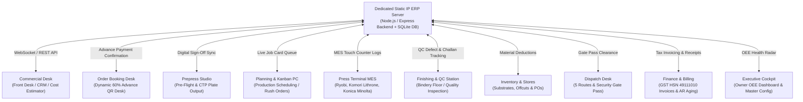

# PrintFlow ERP — AI Governance, Architecture & Project Roadmap (`airules.md`)

**Project:** PrintFlow ERP (Tailored for Josco Printers Master Workflow)
**Primary Objective:** *"Deliver the Right Print, at the Right Quality, on Time – Every Time, with Full Visibility and Control."*
**Deployment Target:** Dedicated Static IP Local/Intranet Server with Multi-User Concurrent Access across all printing press workstations.

---

## 1. Project Vision & Core Objectives

Small-scale offset printing companies operate in a highly dynamic, order-driven manufacturing environment. PrintFlow ERP replaces fragmented spreadsheets and paper job bags with a centralized, high-performance web-based ERP accessible simultaneously across all department terminals via a **Dedicated Static IP Server**.

### Key Problem Areas Solved:
1. **Inaccurate Job Costing:** Precision costing module factoring paper GSM yields, CTP plate counts, CMYK ink coverage, press make-ready runtime, bindery labor, waste margins, and rush fees.
2. **Inventory Stockouts & Mismanagement:** Real-time stock tracking with automated reorder alerts for paper reams, plates, and process inks with two-phase material reservations and offcut lot recycling.
3. **Production Scheduling Conflicts & Idle Time:** Visual Kanban and timeline dashboard mapping sequential stages (`Pre-Press` -> `Plate Making` -> `Press Run` -> `Finishing` -> `Dispatch`) with **1-Click Fast-Track / Bump to Top** for last-minute rush orders.
4. **Siloed Departmental Communication:** Centralized communication hub, automated WhatsApp/Email customer notifications, and internal shift handover logs.
5. **Billing Delays & Credit Risks:** Dynamic UPI payment QR codes, mandatory 60% booking advances, GST-compliant tax invoices, and credit limit enforcement.

---

## 2. Multi-Plant Architecture & Machine Fleet Specification

PrintFlow ERP coordinates operations across two dedicated production locations:
- **Kalkere Branch / Plant**
- **Byrathi Branch / Plant**

### Registered Printing Machine Fleet:
1. **Ryobi 32:** Single/Two-Color Offset Press (`Kalkere Plant` — Max Sheet: 13" x 19", 10,000 IPH)
2. **Ryobi 660:** Multi-Color Offset Press (`Byrathi Plant` — Max Sheet: 20" x 26", 12,000 IPH)
3. **Lithrone 26:** Komori Lithrone 26 Multi-Color Offset Press (`Kalkere Plant` — Max Sheet: 20" x 26", 13,000 IPH)
4. **KMC4080_Kalkere:** Konica Minolta AccurioPress C4080 Digital Production Color Press (`Kalkere Branch` — 81 PPM)
5. **KMC4080_Byrathi:** Konica Minolta AccurioPress C4080 Digital Production Color Press (`Byrathi Branch` — 81 PPM)
6. **KM2100 Black:** Konica Minolta High-Speed Digital Monochrome Press (`Byrathi Branch` — 100 PPM)

---

## 3. Static IP Hosting & Multi-User Concurrency Architecture

The ERP is engineered for seamless multi-user concurrent operation on a localized static IP server (e.g. `http://192.168.1.100:5000` or corporate intranet IP).

---

## 4. Consolidated ERP Architecture: 9 Modules with Synchronized Sub-Tabs

To eliminate UI duplication, improve touch terminal usability on the shop floor, and adhere to standard enterprise ERP design, PrintFlow ERP organizes its complete manufacturing pipeline into **9 High-Level Consolidated Modules** equipped with synchronized internal sub-tabs:

| # | Consolidated Module | Merged Workflows & Features | Internal Sub-Tabs |
|---|---------------------|-----------------------------|-------------------|
| **01** | **Commercial Desk** | Enquiry Management, Master Physical Form, Technical Cost Estimator & Sent Quotes, PO/ARC Validation, 60% Advance Payment Gate, Production Release | **Intake & CRM**, **Quotations** (Pending Quotes, Quoted Records, All Enquiries), **Order Booking** (Booking Queue, Payment QR Desk, Order Confirmations) |
| **02** | **Prepress Studio** | Artwork classification, revision cycles (V1/V2/V3), customer sign-off, CTP plate exposure | **Artwork Pre-Flight**, **Proof Sign-Off**, **CTP Output** |
| **03** | **Planning & Kanban** | Production scheduling across 5 stages, machine load allocation, 1-click rush fast-tracking | **Digital Job Tickets**, **Machine Allocation**, **Rush Fast-Track** |
| **04** | **Press Terminal (MES)** | Touch-friendly shop-floor terminal, live impression counting, make-ready logs, density checks | **Live Terminal**, **Impression Counter**, **Setup & Calibration** |
| **05** | **Finishing & QC** | Guillotine cutting, folding, lamination, binding, outsourced associate challans, QC checklists | **Bindery Operations**, **Outsourced Job-Work**, **QC Inspection** |
| **06** | **Inventory & Stores** | Substrate stock balances, offcut lot cataloging/recycling, supplier POs, inter-branch transfers | **Raw Stock Levels**, **Offcuts & Excess**, **Supplier POs** |
| **07** | **Dispatch & Logistics**| 5-Zone route delivery queues, vehicle/driver assignment, security gate passes, rejection/refund | **Route Tracking & Dispatch**, **Gate Pass Clearance**, **Returns & Rework** |
| **08** | **Finance & Billing** | GST Tax Invoices (HSN `49111010`), dynamic UPI QR settlements, payment receipts, AR aging | **GST Invoicing (HSN 49111010)**, **Receipts & Advances**, **AR Aging** |
| **09** | **Admin & Analytics** | Executive OEE dashboard (84.2% target), automated notifications (WhatsApp/SMS), master configuration | **Executive Dashboard (OEE)**, **Notification Hub**, **Master Data Config** |

---

## 5. The 8 End-to-End Workflow Control Gates

PrintFlow ERP enforces 8 non-negotiable operational checkpoints to ensure zero defects, margin preservation, and complete financial governance:

1. **Gate 1: Specification Completeness**
   - Blocks quote estimation until paper GSM, size, sheet cuts, inks, and bindery specs are defined.
2. **Gate 2: Cost & Margin Lock**
   - Blocks quote dispatch if gross margin falls below the mandatory 25% threshold or paper yields are invalid.
3. **Gate 3: Order Booking & Advance Gate**
   - Strictly blocks production release until either a 60% advance is received via UPI/bank or an approved ARC contract is linked.
4. **Gate 4: Prepress & Proof Sign-Off Gate**
   - Blocks CTP plate exposure until customer explicitly approves proof via WhatsApp/digital sign-off.
5. **Gate 5: Material Staging & Stock Allocation Gate**
   - Blocks offset press run until paper reams and inks are physically reserved in the warehouse.
6. **Gate 6: Press Operator QA Clearance Gate**
   - Requires operator density calibration (1.45 CMYK), registration alignment, and scrap sheet logging.
7. **Gate 7: Pre-Dispatch Quality & Packaging Gate**
   - Requires 100% inspection checklist clearance and moisture-proof packaging sign-off.
8. **Gate 8: Security Gate Pass & Balance Payment Gate**
   - Blocks vehicle departure and physical gate pass clearance until balance payment is settled or approved corporate credit terms apply.

---

## 6. Mandatory AI Engineering & Code Governance Rules

When generating, modifying, or extending code for PrintFlow ERP, the AI assistant **MUST ALWAYS** strictly adhere to the following rules:

1. **Strict No-Emojis Rule:**
   - Do NOT use emojis anywhere in the codebase, user interface, notifications, mock data, logs, or documentation. Use clean Lucide SVG icons, text labels, or badges instead.
2. **Strict Anonymity Rule:**
   - Do NOT include any personal names or registration numbers in the codebase, UI, comments, or documentation.
3. **Strict Git Push Policy:**
   - Do NOT commit or push to Git automatically on every update or task completion.
   - ONLY commit and push to Git when explicitly and directly instructed by the user.
   - Always exclude Excel (`*.xlsx`, `*.xls`) and CSV (`*.csv`) data sheets from Git commits and tracking via `.gitignore`.
4. **Domain Fidelity to Offset Printing:**
   - Always preserve physical offset manufacturing concepts (Sheet cutting yield, CTP plates, CMYK/Pantone ink densities, make-ready scrap allowance, parent sheet sizes 23"x36", 20"x30", 18"x23", GSM weights, and finishing bindery).
5. **Multi-User Concurrency & State Integrity:**
   - State mutations must maintain relational consistency across all consolidated modules.
   - Advancing a stage (e.g. `PressRun`) must automatically trigger two-phase material deductions in `inventory_items` without race conditions.
   - Recording a payment receipt must immediately update invoice balances and the customer's CRM ledger.
6. **Urgent / Rush Order Governance:**
   - Urgent jobs (`is_rush_order = true` or `priority = 'Urgent'`) must always be prominently styled with glowing animations, priority ranking #1, and deadline countdown badges.
   - Fast-track queue reordering must update `queue_position` deterministically across all active jobs.
7. **Security & Role-Based Isolation:**
   - Role permissions must be enforced at the UI and business logic layer to simulate real-world shop floor workstations.
   - Ensure all monetary amounts and tax computations adhere strictly to Indian GST standards (CGST 6%, SGST 6%, IGST 12%).
8. **Documentation & Verification Integrity:**
   - Maintain clear comments, preserve existing docstrings, and update [`walkthrough.md`](file:///c:/Users/noelj/Desktop/swe/walkthrough.md) and [`airules.md`](file:///c:/Users/noelj/Desktop/swe/airules.md) whenever new features or architectural changes are introduced.

---

## 7. Routine Codebase Hygiene, Anti-Redundancy & Minimalism Governance

To maintain high software quality, rapid developer iteration, and prevent codebase bloat:

1. **Routinely Eliminate Redundancy:**
   - On every task, actively scan for and remove duplicate state definitions, duplicate components, and obsolete wrapper functions.
   - **Never create parallel or redundant top-level menus.** Adhere strictly to the **10 Consolidated ERP Modules** hierarchy (`Commercial Desk`, `Order Booking`, `Prepress Studio`, `Planning & Kanban`, `Press Terminal MES`, `Finishing & QC`, `Inventory & Stores`, `Dispatch & Logistics`, `Finance & Billing`, `Admin & Analytics`). New features must be integrated as internal sub-tabs within their respective parent module.
2. **Dead Code & Unused Import Purge:**
   - Whenever modifying any file, immediately eliminate unused imports, obsolete Lucide icon imports, unused local variables, and dead routing branches.
   - Do not leave commented-out obsolete code blocks. Delete obsolete legacy code cleanly.
3. **Single Source of Truth (DRY Principle):**
   - Common calculations (e.g., GST calculation, offset paper ream yields, gross profit margins, gate verifications) must be centralized in utility functions or shared context rather than duplicated across views.
4. **Automated Verification Mandate:**
   - Every code modification or cleanup must be verified with an automated production build (`npm run build` in `client/`).
   - The build must exit with code 0, zero syntax errors, and zero unresolved imports before work is declared complete.
